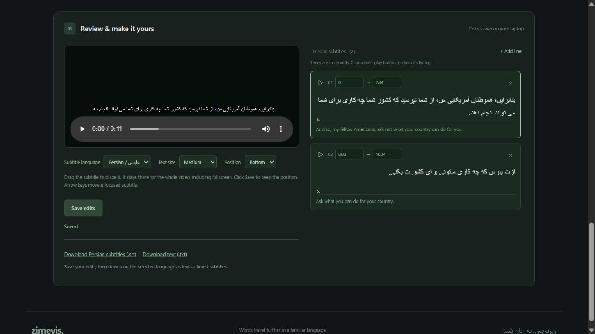

# Zirnevis — Persian Subtitle Studio

**Turn video or voice recordings into editable Persian and English subtitles, on your own laptop.**

Zirnevis is a local web app for Windows. Upload videos or audio recordings, or
choose a YouTube video's available quality. Review timed subtitles, switch
between Persian and English, and export a video with permanent captions.

[راهنمای فارسی](README.fa.md) · [Installation](docs/INSTALLATION.md) · [Full usage guide](docs/USAGE.md) · [Troubleshooting](docs/TROUBLESHOOTING.md)



## Quick start — Windows

1. Install **Python 3.12, 64-bit**, from [python.org](https://www.python.org/downloads/windows/).
   Include the Python launcher or enable **Add Python to PATH**.
2. Download this repository with **Code → Download ZIP**, then extract it to a
   writable folder, such as `Documents\Zirnevis`. Do not run it inside the ZIP.
3. Double-click **Install Studio.cmd**. Installation downloads Python packages,
   FFmpeg through a package dependency, and about **1.1 GB of model files**.
4. When setup finishes, double-click **Start Studio.cmd**.
5. Your browser opens at <http://127.0.0.1:9764>. Keep the launcher window open.

For YouTube links, also install **Node.js 22 or newer** from
[nodejs.org](https://nodejs.org/en/download). It is optional for uploaded files.
No OpenAI API key, paid API subscription, or separate FFmpeg installation is needed.

See [installation instructions](docs/INSTALLATION.md) if Python is missing, a
download fails, or the browser does not open.

## What it can do

- Upload MP4, MKV, MOV, WebM, AVI, and M4V video files.
- Translate MP3, WAV, M4A, FLAC, OGG, OPUS, and AAC voice recordings without video.
- Inspect available YouTube qualities and select one for each video.
- Choose a separate storage-folder name for every project; rename it later.
- Automatically detect speech or select the spoken language.
- Review and edit subtitle wording and start/end times.
- Switch between **Persian** and **English**, including editing and downloads.
- Drag captions to a fixed position for the entire video, including fullscreen.
- Save a position and apply it to permanent subtitles in exported videos.
- Download the selected language as SRT or plain text.
- Export high-quality MP4/H.264 video at the source dimensions.
- Cancel queued or running work; resume supported interrupted work.
- Open saved folders, copy paths, delete projects, or clear the library.

Uploads and downloads have **no app-imposed file-size limit**. There is an
**eight-hour duration limit per project**. Disk space, memory, and processing
time still depend on the computer. Jobs run one at a time.

## Make your first subtitled video

1. Choose **Spoken language**, or use automatic detection.
2. Choose or drop a video, set its folder name, then click **Upload files**.
   For YouTube: paste the link, click **Check available qualities**, choose a
   resolution and folder name, then click **Download & subtitle**.
3. Wait for preparation, speech recognition, and translation. Watch the job card
   for the current step and progress. Keep the launcher open.
4. Review the lines and timing. Use a line's play button to check it.
5. Select **Persian** or **English**. Drag a visible caption to position it, or
   choose a top/bottom preset. Click **Save edits** to keep changes.
6. Click **Export subtitled video**, wait for completion, and download the result.
   The selected language is burned into the video and cannot be switched afterward.

The website's review player can switch languages. For a switchable external-player
experience, keep the original video and download both language SRT files separately.
Zirnevis does not currently export an MP4 with two selectable embedded subtitle tracks.

## Translate a voice recording

Use **Voice & audio translation → Choose audio files**, name the folders, and
upload. The editor shows an audio player with timed captions. Review the Persian
or English text, save edits, and download SRT or TXT. This feature translates
speech **into text**; it does not generate a spoken dub or synthetic voice.

## Where files are stored

Everything is stored under the extracted application folder by default:

```text
data/
  models/                 # Speech and translation models, downloaded once
  jobs/
    My video folder/
      job.json            # Project metadata and saved subtitle edits
      source.mp4          # Original upload; extension varies
      preview-hq.mp4      # Optional playback copy
      captions.ass        # Rendering instructions, after export
      export-subtitles.srt
      persian.srt
      persian-video.mp4   # Last exported video, either selected language
      worker.log
```

Audio projects may have `audio-preview.m4a`. Files depend on the workflow.
`persian-video.mp4` is an internal filename retained for compatibility; the
download's name identifies Persian or English. Browser downloads create an
additional copy in the browser's chosen location.

Click **Open videos folder** or **Open folder** to find a project's files.
**Delete** and **Clear all videos** move project folders to the Windows Recycle
Bin. They also stop affected processing. Models and browser download copies remain.
Older projects may retain an ID-based folder name until you use **Rename folder**.

## How recognition and translation work

1. FFmpeg extracts a mono 16 kHz speech track.
2. [faster-whisper](https://github.com/SYSTRAN/faster-whisper), using Whisper small,
   recognizes speech and produces timed segments on the CPU with int8 computation.
3. The [NLLB-200 distilled 600M](https://huggingface.co/facebook/nllb-200-distilled-600M)
   translation model converts speech text into Persian. English speech supplies
   its recognized text as the English version; other supported speech languages
   get a separate English translation. Persian speech is transcribed directly
   into Persian, with English translated separately.
4. For automatically detected languages outside the direct mapping, Whisper's
   English translation is used as a bridge. This can lose nuance.
5. FFmpeg/libass renders the chosen subtitles for a video export.

Direct mappings: English, Persian, Arabic, Turkish, German, French, Spanish,
Russian, Hindi, Chinese, Japanese, Korean, Portuguese, Italian, and Urdu.

There is no OpenAI API integration in this version. Recognition, translation,
and video rendering run on the laptop. Quality varies with speech clarity,
accents, background noise, names, and technical vocabulary. Review the results;
automatic timing and translation are not guaranteed to be exact.

## Privacy and network use

Uploaded media and subtitle text are processed locally; they are not submitted
to an AI service. First-time installation downloads packages and models. YouTube
features contact YouTube. After setup, uploaded files can be processed offline.
The review page uses no remote fonts or analytics services.

The service listens on `127.0.0.1` and includes local request checks. It is intended
for one person's computer, not public hosting or a shared server. Do not expose
it through a public tunnel. [Paperjoin](https://github.com/Behrooz-Zamanipour/paperjoin)
is a separate browser-only PDF tool that can use static hosting; Zirnevis cannot
run its processing backend on GitHub Pages.

## Requirements and limitations

- Tested environment: Windows on x64, Python 3.12, and a modern desktop browser.
  The provided installer and folder controls target Windows; Linux/macOS setup
  has not been validated.
- CPU processing is supported; no dedicated GPU is required. Long recordings
  and high-resolution exports may take considerable time.
- Reserve several GB for installation, plus enough space for originals, previews,
  and exports. A high-resolution project can need several copies of its media.
- Compatible playback streams are preserved where possible; unsupported codecs
  need a full-resolution conversion. Export re-encodes video at CRF 16 rather than
  being lossless. Audio is copied if compatible or converted to AAC.
- Only the first video and selected/first audio stream are used. Extra audio
  tracks and original embedded subtitles are not preserved by video export.
- YouTube availability, access restrictions, and format changes can cause failures.
  Upload a local copy instead. Only download media you are allowed to use.

## License

The application source is [MIT licensed](LICENSE). **The default translation
model has a separate CC BY-NC 4.0 license, restricting commercial use of that
model.** The MIT license for this application does not change the model's terms.
The model is downloaded during setup and is not included in this repository.
Read [MODEL-NOTICES.txt](MODEL-NOTICES.txt) and
[third-party notices](THIRD_PARTY_NOTICES.md) before redistribution or commercial use.

## Development and support

See [CONTRIBUTING.md](CONTRIBUTING.md), [troubleshooting](docs/TROUBLESHOOTING.md),
and [developer notes](docs/DEVELOPMENT.md). When reporting a problem, include
steps and a redacted error message, not private videos, transcripts, or job folders.
