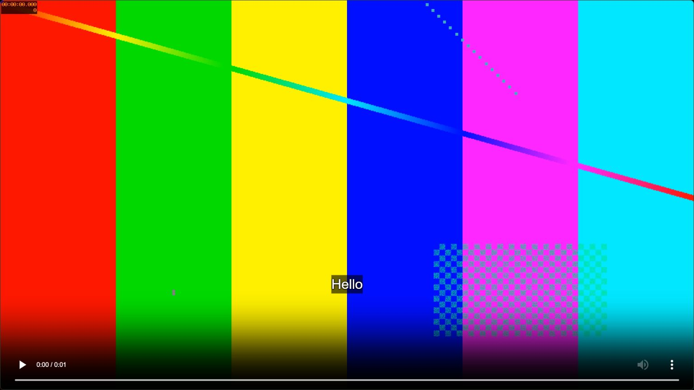

# Using Zirnevis

## 1. Start and choose the spoken language

Open **Start Studio.cmd** and keep the window running. Choose **Spoken language**
before adding media. Automatic detection is convenient; choosing the known
language can help with short or unclear recordings.

## 2. Add video files

Click the video upload area or drop files onto it. A **Name your folders** panel
lets you name each project's storage folder. Click **Upload files** to begin.
Changing a folder name does not change your original file's name or contents.
Duplicate folder names get a numbered suffix, such as `Lesson (2)`. Characters
Windows cannot use in folder names are normalized.

Projects enter a queue and run one at a time. There is no file-size cap in the
app, but projects are limited to eight hours and need sufficient storage.
Choose several videos if needed; each gets its own subtitle project.

## 3. Add a YouTube link

1. Paste a single video's URL.
2. Click **Check available qualities**.
3. Select a resolution offered for that specific video. Available frame rates
   appear in the quality labels when provided by YouTube.
4. Edit **Save in folder** if desired.
5. Click **Download & subtitle**.

The job card shows source dimensions after downloading. Some videos require
sign-in, are restricted, or cannot be downloaded. This version does not provide
a browser-cookie or account-login workflow. Upload a local file instead.

For a different resolution later, use **Change quality** on a finished job.
The new project reuses saved subtitle edits and has its own source and folder.
Export again to create a subtitled video at the new quality.

## 4. Translate audio or a voice recording

In **Voice & audio translation**, choose an MP3, WAV, M4A, FLAC, OGG, OPUS, or AAC.
Name its folder and click **Upload files**. Speech is recognized and translated
just like video speech, but the review panel contains an audio player.

Audio projects provide Persian/English timed subtitles and text downloads.
They do not have a video-export button and do not synthesize a translated voice.

## 5. Understand progress and cancellation

Cards show uploading, downloading, preparing playback, recognizing speech,
translating, or exporting. Percentages describe approximate stages; speed depends
on the computer, source codec, duration, and resolution.

- **Cancel** stops a queued or running job, including its worker processes.
- **Cancel upload** discards the incomplete file and stops the remaining batch.
  Already uploaded jobs remain in the library.
- **Resume / Retry** restarts supported cancelled or failed work. Completed files
  and saved edits remain, but an unfinished recognition stage may run again.
- Closing the launcher interrupts processing. Keep it open until work finishes.

## 6. Review wording and timing

Select a ready project's card. Each subtitle row has a play button, start/end
times in seconds, editable text, and a remove button. Source text appears below.

Use **Subtitle language** to select Persian or English. Each language has its
own text; editing one does not automatically retranslate the other. The two
versions share cue timing. **Add line** inserts a cue if there is space at the
current playback time. Times must stay within the recording and must not overlap.

Choose a known language and review names, numbers, negatives, technical terms,
and sentence boundaries carefully. Automatic translations can change meaning.

Older projects without an English version show **Generate English subtitles**
when you select English. This uses saved text without downloading or recognizing
the video again. Wait for completion before editing the generated English lines.

Click **Save edits** before downloading text/subtitles or leaving the page.
Switching projects attempts to save dirty edits; invalid timings need fixing first.

## 7. Place captions and use fullscreen

Use **Text size** and **Position** for presets. For a custom position, seek to
a visible subtitle and drag it with the mouse. The position applies to every
cue in that project. A focused caption also supports arrow-key movement.
Click **Save edits** to keep the position after reopening the project.

Use the website's **Fullscreen** button or double-click the video. The caption
overlay stays with the video. Double-click again to leave fullscreen; browsers
also normally support Escape. Native picture-in-picture is disabled because a
separate overlay cannot follow into that player.

## 8. Download subtitles, text, or video

- Select a language, save, and click **Download ... subtitles (.srt)** for timed
  subtitles, or **Download text (.txt)** for the text without timestamps.
- To get both languages, download once with Persian selected and again with
  English selected. Give each a distinct filename if your browser prompts.
- **Export subtitled video** burns the selected language and fixed position into
  an MP4. Keep the launcher running until **Export complete**.
- Click **Download video** to save an additional copy through your browser.

Burned captions are permanent pixels; the exported video cannot switch language.
Use the original source with separate SRT files in an external subtitle-capable
player if you want selectable languages outside Zirnevis.

If you edit subtitles after exporting, the existing video is the **last export**.
Export again to include the new text, timing, size, position, or language.

## 9. Manage storage

**Open videos folder** opens the library. A card's **Open folder** opens that
project. **Copy path** is useful if File Explorer does not appear.

**Rename folder** changes a finished project's storage-folder name and keeps its
files and project ID. Active projects cannot be renamed; wait until they finish.
Existing folders are never overwritten by renaming.

**Delete** moves one project to the Windows Recycle Bin. **Clear all videos**
does this for all projects currently in the library, including audio projects.
Affected jobs are stopped first. Model files and browser download copies remain.
Restore a project folder from the Recycle Bin, then restart Zirnevis to load it.
